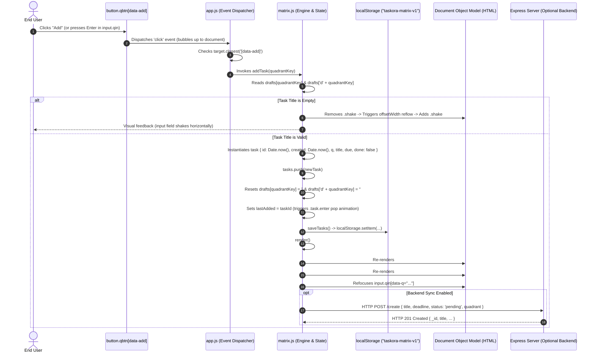

# Taskora: "Add" Button Comprehensive Documentation
**User Guide & Developer Architecture Specification**

---

## Table of Contents
1. [Overview & Scope](#1-overview--scope)
2. [Part 1: User Documentation (End-User Guide)](#2-part-1-user-documentation-end-user-guide)
   - [2.1 Where is the "Add" Button?](#21-where-is-the-add-button)
   - [2.2 Step-by-Step: Adding a Task](#22-step-by-step-adding-a-task)
   - [2.3 What Happens When You Click "Add"?](#23-what-happens-when-you-click-add)
   - [2.4 Visual Feedback & Behaviors](#24-visual-feedback--behaviors)
   - [2.5 Power-User Tips & Keyboard Shortcuts](#25-power-user-tips--keyboard-shortcuts)
   - [2.6 User Troubleshooting & FAQs](#26-user-troubleshooting--faqs)
   - [2.7 Bonus: The "+ Add note" Button](#27-bonus-the--add-note-button)
3. [Part 2: Developer Documentation (Technical Specification)](#3-part-2-developer-documentation-technical-specification)
   - [3.1 System Architecture & Data Flow](#31-system-architecture--data-flow)
   - [3.2 End-to-End Sequence Diagram](#32-end-to-end-sequence-diagram)
   - [3.3 DOM Generation & Attributes](#33-dom-generation--attributes)
   - [3.4 Input Capture & Live State Buffering](#34-input-capture--live-state-buffering)
   - [3.5 Event Delegation in `app.js`](#35-event-delegation-in-appjs)
   - [3.6 Execution Engine: `addTask()` in `matrix.js`](#36-execution-engine-addtask-in-matrixjs)
   - [3.7 Validation & CSS Reflow Animation](#37-validation--css-reflow-animation)
   - [3.8 State Persistence & Sorting Algorithm](#38-state-persistence--sorting-algorithm)
   - [3.9 DOM Re-rendering & Focus Management](#39-dom-re-rendering--focus-management)
   - [3.10 Backend Persistence Integration (`POST /create`)](#310-backend-persistence-integration-post-create)
   - [3.11 Summary Reference Table](#311-summary-reference-table)

---

## 1. Overview & Scope

In **Taskora**, the **"Add" button** is the core interactive trigger for task creation within the Eisenhower Matrix. Each of the four quadrants (`DO NOW`, `DEEP WORK`, `DELEGATE`, and `DROP`) contains a dedicated input area and an "Add" button (`button.qbtn[data-add]`).

This document provides two complete, tailored perspectives:
- **Part 1 (User Documentation):** How the feature behaves from a user's perspective, how to interact with it, visual cues, and best practices.
- **Part 2 (Developer Documentation):** The underlying codebase mechanics, including DOM structure, event listeners, state mutation, CSS animations, localStorage synchronization, and backend Express/MongoDB connectivity.

---

# 2. Part 1: User Documentation (End-User Guide)

### 2.1 Where is the "Add" Button?
In Taskora, tasks are organized into four quadrants based on urgency and importance:
1. **DO NOW (Top Left):** Urgent & Important tasks (24–48 hour deadline).
2. **DEEP WORK (Top Right):** Not Urgent, but Important tasks (long-term goals, planning).
3. **DELEGATE (Bottom Left):** Urgent, but Not Important tasks (routine chores, hand-offs).
4. **DROP (Bottom Right):** Neither Urgent nor Important tasks (distractions, low-value items).

At the bottom of **every single quadrant card**, you will find an input toolbar containing:
- **Text Box:** Where you type the task description (e.g., `"Add to do now..."`).
- **Date Picker:** An optional date field where you choose a deadline.
- **"Add" Button:** A high-contrast button labeled **Add**.

```
+----------------------------------------------------------------+
|  DO NOW                     Urgent * Important         2 open  |
|  [==========================              ] 50%                |
|  ------------------------------------------------------------  |
|  [ ] Fix the demo bug blocking launch                [Today]   |
|  ------------------------------------------------------------  |
|  [ Add to do now...         ] [ YYYY-MM-DD ] [ Add ]          |
|    ^ Text Box                   ^ Date         ^ Add Button    |
+----------------------------------------------------------------+
```

---

### 2.2 Step-by-Step: Adding a Task

1. **Locate your target box:** Decide whether your task is urgent, important, both, or neither.
2. **Type your task name:** Click on the text input box labeled `Add to [box name]...` and type your task description.
3. **(Optional) Set a due date:** Click the small date input field next to the text box and pick a date from the calendar picker.
4. **Click "Add":** Click the **Add** button (or press `Enter` on your keyboard).
5. **Done!** Your task instantly appears at the top of the quadrant with its priority badge.

---

### 2.3 What Happens When You Click "Add"?

When you click the **Add** button:
1. **Instant Placement:** Your new task appears immediately in the quadrant list above the input bar.
2. **Smart Sorting:** 
   - Uncompleted tasks stay at the top.
   - Tasks with earlier deadlines appear above tasks with later deadlines.
   - Newly added tasks without dates appear in chronological order.
3. **Due Date Badge:** If you selected a date, Taskora automatically generates a clean badge:
   - **Overdue:** Displayed in red (e.g., `Nov 6`).
   - **Today:** Highlighted prominently (`Today`).
   - **Tomorrow:** Labeled cleanly (`Tomorrow`).
   - **Future Date:** Labeled with the date (e.g., `Nov 15`).
4. **Analytics Update:** The top analytics bar (Total Tasks, Open Tasks, Completed %, and Progress bar) immediately recalculates.
5. **Input Cleared & Auto-Focused:** The text and date fields clear automatically, and your cursor remains in the text field so you can rapidly type another task without touching your mouse!
6. **Automatic Saving:** Everything is automatically saved to your browser's local memory. You can refresh or close the browser without losing your tasks.

---

### 2.4 Visual Feedback & Behaviors

| User Action | What You See on Screen | Why it Happens |
| :--- | :--- | :--- |
| **Click "Add" with text** | Task slides in with a brief highlight animation (`pop`). Input resets. Counter increments. | Successful creation of the task. |
| **Click "Add" while input is empty** | The text input box shakes horizontally from side to side. | Validation alert: Taskora requires a title before creating a task. No empty items allowed. |
| **Click "Add" with a due date** | A colored date badge (`Today`, `Tomorrow`, or date) appears next to the title. | The due date calculation engine categorizes urgency relative to the current date. |

---

### 2.5 Power-User Tips & Keyboard Shortcuts

- **Press `Enter` instead of clicking:** You do not need to reach for your mouse! After typing your task title, simply press `Enter` on your keyboard to instantly add it.
- **Batch entry:** Because the input box automatically refocuses after submission, you can enter 5 tasks in seconds: `Type -> Enter -> Type -> Enter -> Type -> Enter`.
- **Quick Jump with `/`:** Pressing `/` anywhere on the page instantly highlights the primary input box in the `DO NOW` quadrant.
- **Inline Editing:** Made a typo? Double-click any task title in the list to edit the name or date directly. Press `Enter` to save or `Esc` to cancel.

---

### 2.6 User Troubleshooting & FAQs

#### Q1: Why did the input box shake when I clicked "Add"?
> **Answer:** You clicked "Add" without typing anything in the text field. Taskora requires at least one character in the task title. Type your task and click "Add" again.

#### Q2: Do I have to select a date to add a task?
> **Answer:** No. The date field is 100% optional. If you leave it empty, the task will simply be created without a date badge.

#### Q3: Will my tasks disappear if I refresh the page?
> **Answer:** No. Every task added via the "Add" button is immediately stored in your browser's persistent storage.

---

### 2.7 Bonus: The "+ Add note" Button
In addition to quadrant task adding, Taskora features a rich-text slide-out **Notes drawer** (accessible via the pencil icon in the top-left or pressing the pen button):
- **Button location:** Top header of the Notes drawer (`+ Add note`).
- **Action:** Creates a fresh, timestamped note document.
- **Task Bridge:** Inside notes, you can type slash commands like `/do Buy groceries` and click **Schedule** (or press `Ctrl + Enter`) to automatically convert notes directly into matrix tasks!

---

# 3. Part 2: Developer Documentation (Technical Specification)

### 3.1 System Architecture & Data Flow

When the user clicks the "Add" button, Taskora executes a purely declarative, unidirectional data flow:
1. **DOM Capture:** Centralized event listener delegates the click event via HTML5 dataset attributes.
2. **Buffer Extraction:** Task title and optional date are retrieved from the in-memory `drafts` dictionary.
3. **Validation & UX Reflow:** If empty, a reflow-enforced CSS keyframe animation (`shake`) is executed.
4. **State Mutation:** A new task entity is created and appended to the global `tasks` state array.
5. **Persistence:** State is serialized into `localStorage` (`'taskora-matrix-v1'`).
6. **Reactive Render:** The view engine recalculates matrix metrics, sorts items, generates the virtual HTML, patches the DOM, and re-establishes user input focus.
7. **Cloud API Sync (Backend):** Can optionally be routed to the Express `POST /create` REST endpoint.

---

### 3.2 End-to-End Sequence Diagram



---

### 3.3 DOM Generation & Attributes

The input group containing the "Add" button is dynamically generated inside `frontend/js/matrix.js` by the `quadHTML(quadrantKey)` function:

* **File:** `frontend/js/matrix.js` (lines 297–301)
```html
<div class="qadd">
  <input 
    class="qin" 
    data-q="${quadrantKey}" 
    value="${escapeHTML(taskDraft)}" 
    placeholder="Add to ${quadrant.label.toLowerCase()}…" 
    autocomplete="off">
  <input 
    type="date" 
    class="qdate" 
    data-q="${quadrantKey}" 
    value="${dateDraft}">
  <button 
    class="qbtn" 
    data-add="${quadrantKey}">Add</button>
</div>
```

#### Key Attributes & Schema:
- `data-add="${quadrantKey}"`: Injects the quadrant identifier (`"do"`, `"decide"`, `"delegate"`, `"delete"`). This allows a single generic click handler to know exactly which quadrant triggered the action without hardcoding element IDs.
- `class="qbtn"`: Applied for styling (pill shape, high-contrast theme background, bold typography).

---

### 3.4 Input Capture & Live State Buffering

Before the user ever clicks "Add", an input event listener continuously buffers keystrokes into an in-memory dictionary `drafts`.

* **File:** `frontend/js/app.js` (lines 280–287)
```javascript
// Save quadrant task title and due date drafts in memory as object 
if (target.classList.contains('qin')) {
  drafts[target.dataset.q] = target.value;
}
if (target.classList.contains('qdate')) {
  drafts['d' + target.dataset.q] = target.value;
}
```

#### Why buffer into `drafts`?
1. **Decoupled State:** When `render()` executes (e.g., if a background timer or filter fires), any unsubmitted text is preserved and re-injected into `value="${escapeHTML(taskDraft)}"`.
2. **Speed:** Eliminates DOM query lookups at click time; values are already indexed by quadrant key.

---

### 3.5 Event Delegation in `app.js`

Taskora uses the **Event Delegation pattern** on the root `document` rather than attaching individual event listeners to each button. This prevents memory leaks and ensures newly rendered quadrants immediately respond to clicks.

* **File:** `frontend/js/app.js` (lines 40–48)
```javascript
// 3. Quadrant "+ Add" Task Button
const addButton = target.closest('[data-add]');
if (addButton) {
  addTask(addButton.dataset.add);
  return;
}
```

#### Keyboard Alternate Trigger:
Pressing `Enter` inside `.qin` or `.qdate` also routes directly to `addTask()`:
* **File:** `frontend/js/app.js` (lines 360–366)
```javascript
// 5. Quadrant task input submit on Enter
const isQuadrantInput = target.classList.contains('qin') || target.classList.contains('qdate');
if (isQuadrantInput && event.key === 'Enter') {
  event.preventDefault();
  addTask(target.dataset.q);
  return;
}
```

---

### 3.6 Execution Engine: `addTask()` in `matrix.js`

The `addTask(quadrantKey)` function is the primary controller logic for task creation.

* **File:** `frontend/js/matrix.js` (lines 380–419)
```javascript
/** Adds a new task into the specified quadrant */
function addTask(quadrantKey) {
  const inputElement = document.querySelector(`.qin[data-q="${quadrantKey}"]`);
  const taskTitle = (drafts[quadrantKey] || '').trim();

  // If title is empty, trigger a gentle shake animation to prompt user input
  if (!taskTitle) {
    if (inputElement) {
      inputElement.classList.remove('shake');
      // Trigger layout reflow to restart animation
      void inputElement.offsetWidth;
      inputElement.classList.add('shake');
    }
    return;
  }

  const taskId = Date.now();
  const dueDate = drafts['d' + quadrantKey] || '';

  tasks.push({
    id: taskId,
    created: taskId,
    q: quadrantKey,
    title: taskTitle,
    due: dueDate,
    done: false
  });

  // Reset drafts for this quadrant
  drafts[quadrantKey] = '';
  drafts['d' + quadrantKey] = '';
  lastAdded = taskId;

  saveTasks();
  render();

  // Return focus to input for fast batch entry
  const refreshedInput = document.querySelector(`.qin[data-q="${quadrantKey}"]`);
  if (refreshedInput) refreshedInput.focus();
}
```

---

### 3.7 Validation & CSS Reflow Animation

When `taskTitle.trim()` evaluates to an empty string, the application triggers a CSS animation without disrupting the UI.

#### Reflow Trigger Mechanics:
```javascript
inputElement.classList.remove('shake');
void inputElement.offsetWidth; // FORCED SYNCHRONOUS REFLOW
inputElement.classList.add('shake');
```
* **Why `void inputElement.offsetWidth` is necessary:** Browsers optimize CSS changes by batching DOM modifications. If `.shake` is removed and immediately added in the same execution frame, the browser will ignore both and no animation will play if the user clicks "Add" multiple times consecutively. Accessing `offsetWidth` forces the rendering engine to recalculate geometry immediately, ensuring the keyframe animation resets and plays every single time.

#### CSS Animation Definition:
* **File:** `frontend/css/style.css` (lines 556–567)
```css
.shake {
  animation: shake 0.35s;
}

@keyframes shake {
  25% {
    transform: translateX(-4px);
  }
  75% {
    transform: translateX(4px);
  }
}
```

---

### 3.8 State Persistence & Sorting Algorithm

#### State Object Schema:
Each task object created by the "Add" button conforms to the following schema:
```typescript
interface Task {
  id: number;        // Epoch timestamp generated via Date.now()
  created: number;   // Epoch timestamp of creation
  q: string;         // 'do' | 'decide' | 'delegate' | 'delete'
  title: string;     // Task title text (sanitized on render via escapeHTML)
  due: string;       // Date string 'YYYY-MM-DD' or empty string ''
  done: boolean;     // Default: false
}
```

#### Persistence:
* **File:** `frontend/js/matrix.js` (lines 157–160)
```javascript
function saveTasks() {
  store.set(KEY, JSON.stringify(tasks)); // KEY = 'taskora-matrix-v1'
}
```

#### Sorting Order (`sortTasks()`):
Every time `render()` runs after adding a task, tasks are sorted using a multi-tier comparator:
1. **Completion:** Uncompleted tasks (`done === false`) sort before completed ones.
2. **Due Date:** Earliest due date appears first. Undated tasks resolve to `Infinity` and are placed at the bottom.
3. **Creation Order:** Ties are broken by `created` timestamp.

---

### 3.9 DOM Re-rendering & Focus Management

1. **New Item Entrance Animation:**
   `lastAdded = taskId;` is set right before `render()`. When `itemHTML(task)` processes the task matching `lastAdded`, it injects the `.enter` CSS class:
   ```css
   .task.enter {
     animation: pop 0.6s;
   }
   @keyframes pop {
     from { border-color: var(--accent); }
     to { border-color: transparent; }
   }
   ```
2. **Focus Retention:**
   Because `render()` replaces `.innerHTML` of `#matrix`, the active focus element is naturally destroyed. To preserve developer and user ergonomics, `addTask()` explicitly queries the newly created input field and calls:
   ```javascript
   const refreshedInput = document.querySelector(`.qin[data-q="${quadrantKey}"]`);
   if (refreshedInput) refreshedInput.focus();
   ```

---

### 3.10 Backend Persistence Integration (`POST /create`)

Taskora includes a companion Node.js/Express backend capable of persisting tasks directly to a MongoDB Atlas cluster.

#### API Endpoint:
- **Method:** `POST`
- **Route:** `/create`
- **Handler:** `createTodo` in `backend/controllers/todoController.js`

#### Request Payload:
```json
{
  "title": "Fix the login bug blocking the demo",
  "deadline": "2026-11-09T00:00:00.000Z",
  "status": "pending",
  "quadrant": "do"
}
```

#### Controller Implementation:
* **File:** `backend/controllers/todoController.js` (lines 5–29)
```javascript
export const createTodo = async (req, res) => {
  try {
    const { title, deadline, status, quadrant } = req.body;

    if (!title) {
      return res.status(400).json({ message: 'Title is required' });
    }

    const newTodo = await Todo.create({
      title,
      deadline: deadline || null,
      status: status || 'pending',
      quadrant: quadrant || 'do',
    });

    res.status(201).json(newTodo);
  } catch (error) {
    res.status(500).json({ message: error.message });
  }
};
```

---

### 3.11 Summary Reference Table

| Layer | File Path | Code Symbol / Selector | Function / Responsibility |
| :--- | :--- | :--- | :--- |
| **Markup** | `frontend/js/matrix.js` | `<button class="qbtn" data-add="...">` | Renders the clickable button in quadrant footer |
| **Styling** | `frontend/css/style.css` | `.qbtn`, `.qin`, `.shake`, `.task.enter` | Button geometry, themes, and keyframe animations |
| **Buffering** | `frontend/js/app.js` | `document.addEventListener('input')` | Real-time synchronization of title & date into `drafts` |
| **Listener** | `frontend/js/app.js` | `document.addEventListener('click')` | Delegated event listener matching `[data-add]` |
| **Keyboard** | `frontend/js/app.js` | `document.addEventListener('keydown')` | Handles `Enter` key submission from input fields |
| **Controller** | `frontend/js/matrix.js` | `addTask(quadrantKey)` | Validation, task instantiation, and draft cleanup |
| **Storage** | `frontend/js/matrix.js` | `saveTasks()` | JSON serialization to browser `localStorage` |
| **View Engine**| `frontend/js/matrix.js` | `render()`, `sortTasks()`, `dueBadge()` | Recalculates stats, re-sorts list, injects HTML |
| **Focus** | `frontend/js/matrix.js` | `refreshedInput.focus()` | Refocuses cursor for rapid sequential entry |
| **Server Route**| `backend/index.js` | `app.post('/create', createTodo)` | Express REST route handler |
| **Database** | `backend/controllers/todoController.js` | `Todo.create()` | Inserts document into MongoDB Atlas collection |
