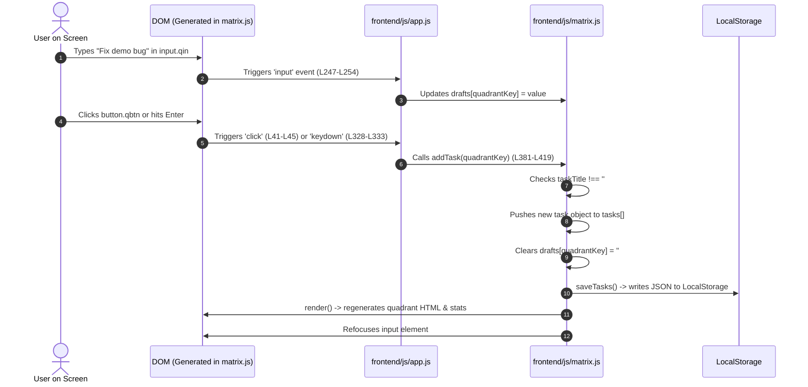
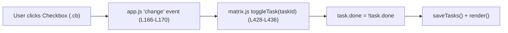
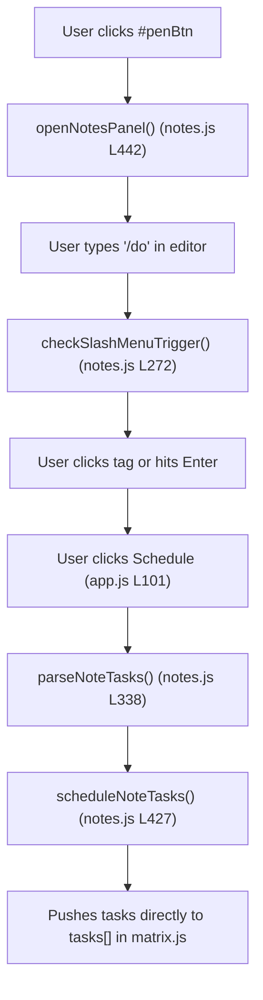
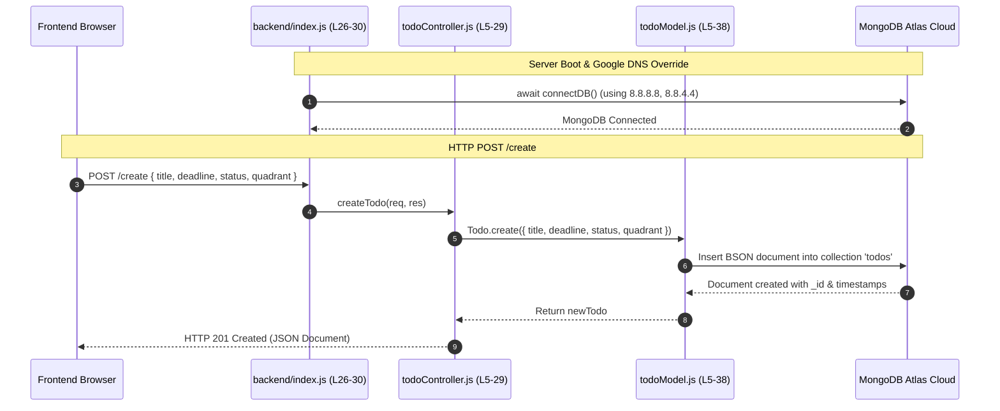

# Taskora - Code-Accurate Execution Flow & Architecture Guide

This guide is designed for developers, students, and engineers who want to read through the Taskora codebase and understand **exactly where to look** in their own files. 

Every single code snippet below is **the exact, literal code running in your project right now**, tagged with its real file path and line numbers so you can jump directly to it in VS Code.

---

## 1. The Core Lifecycle: Creating a Task in a Quadrant

Let's follow the complete path of a task: from the user typing in the input box, to the event listener catching it, to the array storing it, and the screen updating.



---

### Step 1.1: Where Does the User Enter the Task?
The input bar is dynamically generated at the bottom of each quadrant by the `quadHTML()` function.

* **File:** `frontend/js/matrix.js` lines 297–301
```javascript
      <div class="qadd">
        <input class="qin" data-q="${quadrantKey}" value="${escapeHTML(taskDraft)}" placeholder="Add to ${quadrant.label.toLowerCase()}…" aria-label="New task in ${quadrant.label}" autocomplete="off">
        <input type="date" class="qdate" data-q="${quadrantKey}" value="${dateDraft}" aria-label="Due date">
        <button class="qbtn" data-add="${quadrantKey}">Add</button>
      </div>
```

#### What this generates on the user's screen:
1. `<input class="qin" data-q="do">`: Text field with placeholder `"Add to do now…"`. The `data-q="do"` attribute explicitly tells the code which quadrant this box belongs to!
2. `<input type="date" class="qdate" data-q="do">`: The date picker input.
3. `<button class="qbtn" data-add="do">Add</button>`: The blue Add button.

---

### Step 1.2: Who Reads the Input as the User Types?
As the user types letters into the input box, who is listening?

* **File:** `frontend/js/app.js` lines 247–254
```javascript
/* ---------- Live Input Synchronization ---------- */
document.addEventListener('input', event => {
  const target = event.target;

  // ... (notes autosave checks above) ...

  // Save quadrant task title and due date drafts in memory as object 
  if (target.classList.contains('qin')) {
    drafts[target.dataset.q] = target.value;
  }
  if (target.classList.contains('qdate')) {
    drafts['d' + target.dataset.q] = target.value;
  }
});
```

#### Why this code exists:
- Instead of adding 8 separate listeners to 4 text inputs and 4 date inputs, `app.js` attaches **one single listener** to the entire document.
- Whenever a keystroke occurs, it checks: `target.classList.contains('qin')`.
- It saves the text in the global `drafts` object: `drafts['do'] = 'Fix demo bug'`.
- If the user resizes the window or changes themes, their typed text is stored in `drafts` and is **never erased**.

---

### Step 1.3: Who Catches the "Add" Click or the "Enter" Key?
The user can submit their task in two ways:

#### Way A: User Clicks the "Add" Button
* **File:** `frontend/js/app.js` lines 40–45
```javascript
  // 3. Quadrant "+ Add" Task Button
  const addButton = target.closest('[data-add]');
  if (addButton) {
    addTask(addButton.dataset.add);
    return;
  }
```

#### Way B: User Hits the "Enter" Key Inside the Input
* **File:** `frontend/js/app.js` lines 327–333
```javascript
  // 5. Quadrant task input submit on Enter
  const isQuadrantInput = target.classList.contains('qin') || target.classList.contains('qdate');
  if (isQuadrantInput && event.key === 'Enter') {
    event.preventDefault();
    addTask(target.dataset.q);
    return;
  }
```

Both paths extract the quadrant key (`'do'`, `'decide'`, `'delegate'`, or `'delete'`) and pass it to **`addTask(quadrantKey)`**.

---

### Step 1.4: What Code Actually Creates and Saves the Task?
The function `addTask()` receives the quadrant key and handles the entire task creation lifecycle.

* **File:** `frontend/js/matrix.js` lines 381–419
```javascript
/** Adds a new task into the specified quadrant */
function addTask(quadrantKey) {
  const inputElement = document.querySelector(`.qin[data-q="${quadrantKey}"]`);
  const taskTitle = (drafts[quadrantKey] || '').trim();

  // If title is empty, trigger a gentle shake animation to prompt user input
  if (!taskTitle) {
    if (inputElement) {
      inputElement.classList.remove('shake');
      // Trigger layout reflow to restart animation
      void inputElement.offsetWidth;
      inputElement.classList.add('shake');
    }
    return;
  }

  const taskId = Date.now();
  const dueDate = drafts['d' + quadrantKey] || '';

  tasks.push({
    id: taskId,
    created: taskId,
    q: quadrantKey,
    title: taskTitle,
    due: dueDate,
    done: false
  });

  // Reset drafts for this quadrant
  drafts[quadrantKey] = '';
  drafts['d' + quadrantKey] = '';
  lastAdded = taskId;

  saveTasks();
  render();

  // Return focus to input for fast batch entry
  const refreshedInput = document.querySelector(`.qin[data-q="${quadrantKey}"]`);
  if (refreshedInput) refreshedInput.focus();
}
```

#### Line-by-Line Breakdown:
1. **Lines 382–383:** Reads the input element and gets the text typed in `drafts[quadrantKey]`.
2. **Lines 386–394 (Validation):** If the user clicked "Add" without typing anything, it triggers the CSS `.shake` animation on the text input.
3. **Lines 396–397:** Uses `Date.now()` to create a timestamp ID (e.g., `1730663456789`).
4. **Lines 399–406:** Pushes the new task object into the `tasks` array.
5. **Lines 409–411:** Clears the memory draft so the input box becomes empty again. Sets `lastAdded = taskId` (which triggers a CSS slide-in animation).
6. **Line 413 (`saveTasks()`):** Writes the array to `localStorage`:
   ```javascript
   function saveTasks() {
     store.set(KEY, JSON.stringify(tasks));
   }
   ```
7. **Line 414 (`render()`):** Rebuilds the DOM HTML for all quadrants and the top progress bar.
8. **Lines 417–418:** Immediately refocuses the input box so the user can type the next task without reaching for the mouse!

---

## 2. Completing a Task: Clicking the Checkbox

What happens when a user clicks the round checkbox next to a task?



### The Actual Event Listener in `app.js`
* **File:** `frontend/js/app.js` lines 162–170
```javascript
  const taskElement = target.closest('.task');
  if (!taskElement || !taskElement.dataset.id) return;
  const taskId = Number(taskElement.dataset.id);

  // 3. Task Completion Checkbox
  if (target.classList.contains('cb')) {
    toggleTask(taskId);
    return;
  }
```

### The Actual Handler in `matrix.js`
* **File:** `frontend/js/matrix.js` lines 428–436
```javascript
/** Toggles complete / incomplete status of a task */
function toggleTask(taskId) {
  const task = tasks.find(item => item.id === taskId);
  if (!task) return;

  task.done = !task.done;
  saveTasks();
  render();
  refocus(taskId);
}
```

#### What happens on screen during `render()`:
1. `sortTasks()` runs: completed tasks automatically sink to the bottom of the list.
2. The task text gets a strike-through line (`.done`).
3. The top stats bar increases the **Completed** count and recalculates the progress bar percentage.

---

## 3. Deleting a Task & The 5-Second Undo

When hovering over a task, an `✕` delete button appears on the right.

### Step 3.1: Clicking the Delete Button
* **File:** `frontend/js/app.js` lines 60–66
```javascript
  // 5. Task Delete Button (✕ on task hover)
  const taskDeleteButton = target.closest('.del');
  if (taskDeleteButton) {
    const taskElement = taskDeleteButton.closest('.task');
    if (taskElement && taskElement.dataset.id) {
      removeTask(Number(taskElement.dataset.id));
    }
    return;
  }
```

### Step 3.2: Removing the Task and Stashing for Undo
* **File:** `frontend/js/matrix.js` lines 439–450
```javascript
/** Deletes a single task and caches it for undo */
function removeTask(taskId) {
  const taskToDelete = tasks.find(item => item.id === taskId);
  if (!taskToDelete) return;

  lastNoteDel = null; // Clear opposite undo pointer
  lastRemoved = [taskToDelete];
  tasks = tasks.filter(item => item.id !== taskId);

  saveTasks();
  render();
  showToast('Task deleted', true);
}
```

### Step 3.3: What Happens if the User Clicks "Undo"?
The notification toast in the bottom corner displays `Task deleted [Undo]`. If clicked:

* **File:** `frontend/js/app.js` lines 35–38
```javascript
  if (target.closest('#undoBtn')) {
    undo();
    return;
  }
```

* **File:** `frontend/js/matrix.js` lines 486–495
```javascript
  // 2. Undo task deletion
  if (!lastRemoved || lastRemoved.length === 0) return;

  tasks.push(...lastRemoved);
  lastRemoved = null;

  saveTasks();
  render();
  hideToast();
```
The deleted task is restored to its original quadrant with its original due date and completion state intact!

---

## 4. The Notes Workspace & Slash Command Parser

In the top header, clicking the pencil icon (`#penBtn`) opens the slide-out Notes panel.



### Step 4.1: Live Autocomplete When Typing `/`
* **File:** `frontend/js/notes.js` lines 272–306
- When typing in the editor, `checkSlashMenuTrigger()` reads the caret text offset.
- If the word starts with `/`, it matches against `ORDER` (`'do'`, `'decide'`, `'delegate'`, `'delete'`).
- It calculates `s.getRangeAt(0).getBoundingClientRect()` and positions the floating `#slash` menu right beneath the blinking cursor.

### Step 4.2: Converting Note Lines into Matrix Tasks
When the user clicks the **"Schedule"** button in the notes toolbar (or presses `Ctrl + Enter`):

* **File:** `frontend/js/app.js` lines 101–104
```javascript
  // 15. Schedule Tagged Tasks into the Matrix
  if (target.closest('#schedBtn')) {
    scheduleNoteTasks();
    return;
  }
```

* **File:** `frontend/js/notes.js` lines 427–453
```javascript
/** Schedules all tagged lines from the active note directly into the matrix */
function scheduleNoteTasks() {
  const plainText = extractPlainText(editor.innerHTML);
  const { out } = parseNoteTasks(plainText);
  const timestamp = Date.now();
  let scheduledCount = 0;

  ORDER.forEach(quadrantKey => {
    out[quadrantKey].forEach(taskTitle => {
      const taskId = timestamp + scheduledCount;
      tasks.push({
        id: taskId,
        created: taskId,
        q: quadrantKey,
        title: taskTitle,
        due: '',
        done: false
      });
      scheduledCount++;
    });
  });

  if (scheduledCount === 0) {
    return showToast('No tasks found in this note', false);
  }

  saveTasks();
  render();
  showToast(`${scheduledCount} task${scheduledCount === 1 ? '' : 's'} scheduled`, false);
}
```
The tasks written in your scratchpad note are parsed and pushed directly into the 4 Eisenhower boxes!

---

## 5. The Backend & Cloud Database Layer

Your backend is a complete Node.js/Express application with MongoDB Atlas integration.



### 5.1 The Server Bootstrap
* **File:** `backend/index.js` lines 14–31
```javascript
// Connect to MongoDB database before handling requests use await here
await connectDB();

// Initialize the Express application
const app = express();

// Set the port number
const PORT = process.env.PORT || 3000;

// Parse incoming JSON request bodies
app.use(express.json());

// POST route to create a task
app.post('/create', createTodo);

// DELETE route to delete a task by ID (supports URL parameter or request body)
app.delete('/delete/:id', deleteTodo);
```

### 5.2 Google Public DNS Override
* **File:** `backend/config/dbConnection.js` lines 3–19
```javascript
import dns from 'dns';

// Set Google Public DNS to prevent querySrv ECONNREFUSED errors
dns.setServers(['8.8.8.8', '8.8.4.4']);

// Function to establish connection with MongoDB
const connectDB = async () => {
  try {
    // Connect to MongoDB database
    const conn = await mongoose.connect(process.env.MONGO_URI);
    // conn.connection.host stores the database host address where MongoDB is connected
    console.log(`MongoDB Connected: ${conn.connection.host}`);
  } catch (error) {
    // error.message contains the text description of why the connection failed
    console.error(`MongoDB Connection Error: ${error.message}`);
  }
};
```

### 5.3 Controller Handling: Task Creation
* **File:** `backend/controllers/todoController.js` lines 5–29
```javascript
// Controller function to handle task creation
export const createTodo = async (req, res) => {
  try {
    // Extract task fields from the request body
    const { title, deadline, status, quadrant } = req.body;

    // Check if title was provided
    if (!title) {
      return res.status(400).json({ message: 'Title is required' });
    }

    // Create a new task document in MongoDB
    const newTodo = await Todo.create({
      title,
      deadline: deadline || null,
      status: status || 'pending',
      quadrant: quadrant || 'do',
    });

    // Send back the created task with 201 Created status
    res.status(201).json(newTodo);
  } catch (error) {
    // Send back error message with 500 Server Error status
    res.status(500).json({ message: error.message });
  }
};
```

### 5.4 Database Schema Definition
* **File:** `backend/models/todoModel.js` lines 5–35
```javascript
// Define the schema for a task
const todoSchema = new mongoose.Schema(
  {
    // Task title/description
    title: {
      type: String,
      required: true,
      trim: true,
    },
    // Optional deadline date
    deadline: {
      type: Date,
      default: null,
    },
    // Task status: pending or completed
    status: {
      type: String,
      enum: ['pending', 'completed'],
      default: 'pending',
    },
    // Eisenhower Matrix box: do, decide, delegate, delete
    quadrant: {
      type: String,
      enum: ['do', 'decide', 'delegate', 'delete'],
      default: 'do',
    },
  },
  {
    // Automatically manage createdAt and updatedAt timestamps
    timestamps: true,
  }
);
```

---

## 6. Quick Reference Table: User Action to Exact Code

| # | What You Do on the Screen | Listener Code Executed | Action Function Executed | End Result |
| :---: | :--- | :--- | :--- | :--- |
| **1** | Type in *"Add to do now..."* | `app.js` (L247-L254) | Saves to `drafts['do']` | Keystrokes safely preserved in memory. |
| **2** | Click the blue **Add** button | `app.js` (L40-L45) | `matrix.js` `addTask()` (L381) | Task appended to `tasks[]`, saved to `localStorage`, DOM re-rendered. |
| **3** | Hit **Enter** while typing | `app.js` (L327-L333) | `matrix.js` `addTask()` (L381) | Same as clicking Add. |
| **4** | Click the round checkbox | `app.js` (L166-L170) | `matrix.js` `toggleTask()` (L428) | Task completion flipped; sorted to bottom. |
| **5** | Click **✕** to delete | `app.js` (L60-L66) | `matrix.js` `removeTask()` (L439) | Task removed; 5-second undo toast shown. |
| **6** | Click **Undo** button in toast | `app.js` (L35-L38) | `matrix.js` `undo()` (L470) | Deleted task restored to original box. |
| **7** | Click top pencil icon (`#penBtn`) | `app.js` (L23-L26) | `notes.js` `openNotesPanel()` | Slide-out notes workspace opens. |
| **8** | Type `/do` in notes | `notes.js` (L272) | `checkSlashMenuTrigger()` | Dropdown appears directly under cursor. |
| **9** | Click **Schedule** in notes | `app.js` (L101-L104) | `notes.js` `scheduleNoteTasks()` | Note text parsed into matrix boxes. |
| **10**| Send HTTP `POST /create` | Express router (L27) | `todoController.js` `createTodo()`| New document saved to MongoDB Atlas cluster. |
