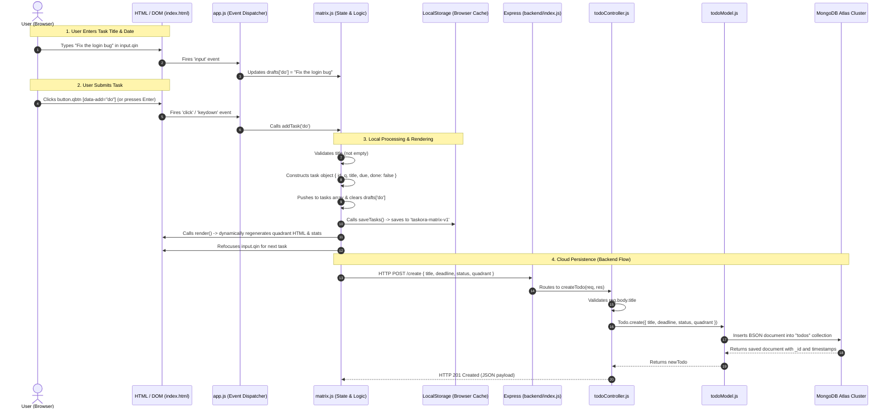

# Taskora - End-to-End Task Creation & Execution Flow

This document details the exact, step-by-step lifecycle of a task in Taskora: from the moment a user types into an input field, through the event listeners and state managers, to the backend Express controller and MongoDB Atlas database.

---

## 1. Complete Visual Flow Diagram



---

## 2. Step 1: Where Does the User Enter the Task?

In Taskora, there are **two distinct entry points** for creating a task:

### Entry Point A: The Direct Quadrant Input Bar (Primary)
At the bottom of each of the 4 Eisenhower quadrants, there is a dedicated input bar:

* **File:** Generated in `frontend/js/matrix.js` inside `quadHTML(quadrantKey)`:
```html
<!-- Example: DO NOW Quadrant Input Bar -->
<div class="qadd">
  <!-- Task Title Input -->
  <input 
    class="qin" 
    data-q="do" 
    value="" 
    placeholder="Add to do now…" 
    aria-label="New task in DO NOW" 
    autocomplete="off">

  <!-- Due Date Input -->
  <input 
    type="date" 
    class="qdate" 
    data-q="do" 
    value="" 
    aria-label="Due date">

  <!-- Submit Button -->
  <button class="qbtn" data-add="do">Add</button>
</div>
```

| HTML Element | Selector / Attribute | Role |
| :--- | :--- | :--- |
| `<input class="qin">` | `data-q="do"` (or `decide`, `delegate`, `delete`) | Captures the task title text. The `data-q` attribute tells the system which quadrant this task belongs to. |
| `<input type="date" class="qdate">` | `data-q="do"` | Captures an optional deadline date. |
| `<button class="qbtn">` | `data-add="do"` | The button the user clicks to submit the task. |

---

### Entry Point B: The Notes Drawer (Batch / Natural Language)
Users can also open the slide-out Notes panel (click the top-left pencil icon or press `penBtn`) and type tasks using slash commands:
* **File:** `frontend/index.html` lines 101–104
```html
<div class="editor" id="nText" contenteditable="true">
  /do now Fix the login bug
  /deep work Write architecture specs
</div>
```

---

## 3. Step 2: Who is Responsible to Read the Input as the User Types?

When the user types inside the task input field, **who captures that data?**

### The Responsible Code: `app.js` (Input Listener)
* **File:** `frontend/js/app.js` lines 166–198

```javascript
/* ---------- Live Input Synchronization ---------- */
document.addEventListener('input', event => {
  const target = event.target;

  // Reads task title keystrokes and saves to in-memory draft
  if (target.classList.contains('qin')) {
    drafts[target.dataset.q] = target.value;
  }

  // Reads due date changes and saves to in-memory date draft
  if (target.classList.contains('qdate')) {
    drafts['d' + target.dataset.q] = target.value;
  }
});
```

### Why Does This Exist?
* As the user types, the keystrokes are stored in the global `drafts` object (`drafts['do'] = 'Fix the login bug'`).
* **Benefit:** If the user switches focus, opens notes, or resizes the screen, **their typed text is never lost**.

---

## 4. Step 3: Who is Responsible When the User Clicks "Add" or Presses Enter?

When the user is ready to add the task, they can do so in two ways:
1. **Click the button:** `<button class="qbtn" data-add="do">Add</button>`
2. **Press `Enter`:** While typing in `.qin` or `.qdate`.

### The Responsible Listener: `app.js`

#### A. If User Clicks "Add":
* **File:** `frontend/js/app.js` lines 32–36
```javascript
// 3. Quadrant "+ Add" Task Button Clicked
const addButton = target.closest('[data-add]');
if (addButton) {
  addTask(addButton.dataset.add); // Passes "do", "decide", etc.
  return;
}
```

#### B. If User Presses `Enter`:
* **File:** `frontend/js/app.js` lines 255–260
```javascript
// 5. Quadrant task input submit on Enter key
const isQuadrantInput = target.classList.contains('qin') || target.classList.contains('qdate');
if (isQuadrantInput && event.key === 'Enter') {
  event.preventDefault();
  addTask(target.dataset.q); // Passes "do", "decide", etc.
  return;
}
```

Both triggers pass control to the core function: **`addTask(quadrantKey)`**.

---

## 5. Step 4: What Happens Inside `addTask()`?

`addTask()` is the central processing engine for task creation.

* **File:** `frontend/js/matrix.js` lines 257–298

```javascript
function addTask(quadrantKey) {
  const inputElement = document.querySelector(`.qin[data-q="${quadrantKey}"]`);
  const taskTitle = (drafts[quadrantKey] || '').trim();

  // 1. VALIDATION: Check if user entered an empty title
  if (!taskTitle) {
    if (inputElement) {
      inputElement.classList.remove('shake');
      void inputElement.offsetWidth; // Reflow for CSS animation
      inputElement.classList.add('shake');
    }
    return;
  }

  // 2. CONSTRUCT TASK OBJECT
  const taskId = Date.now();
  const dueDate = drafts['d' + quadrantKey] || '';

  tasks.push({
    id: taskId,
    created: taskId,
    q: quadrantKey,
    title: taskTitle,
    due: dueDate,
    done: false
  });

  // 3. RESET IN-MEMORY DRAFTS
  drafts[quadrantKey] = '';
  drafts['d' + quadrantKey] = '';
  lastAdded = taskId;

  // 4. PERSIST TO STORAGE
  saveTasks();

  // 5. RE-RENDER INTERFACE
  render();

  // 6. RETURN FOCUS FOR RAPID INPUT
  const refreshedInput = document.querySelector(`.qin[data-q="${quadrantKey}"]`);
  if (refreshedInput) refreshedInput.focus();
}
```

### Detailed Breakdown of Steps:
1. **Validation:** Checks if `taskTitle` is empty. If empty, it adds a CSS `.shake` class to the input to prompt the user.
2. **Object Creation:** Creates a clean task object with unique timestamp ID:
   ```javascript
   {
     id: 1730663400000,
     created: 1730663400000,
     q: 'do',
     title: 'Fix the login bug',
     due: '2026-11-04',
     done: false
   }
   ```
3. **Draft Cleanup:** Clears the input field memory so the input becomes empty again.
4. **`saveTasks()`:** Serializes the `tasks` array to LocalStorage (`localStorage.setItem('taskora-matrix-v1', JSON.stringify(tasks))`).
5. **`render()`:** Re-builds the quadrant task list, updates progress bars, and recalculates analytics.
6. **Focus Restoration:** Immediately refocuses the input field so the user can type the next task without touching their mouse.

---

## 6. Step 5: How the Request Reaches the Backend & Database

When fullstack cloud persistence is active, the data flows from the browser to the Node.js Express server and MongoDB Atlas.

### 1. Client Dispatches HTTP Request
The client sends an HTTP POST request to the backend:
```javascript
// HTTP POST Request sent by client
fetch('http://localhost:3000/create', {
  method: 'POST',
  headers: { 'Content-Type': 'application/json' },
  body: JSON.stringify({
    title: 'Fix the login bug',
    deadline: '2026-11-04',
    status: 'pending',
    quadrant: 'do'
  })
});
```

### 2. Express Server Receives the Request
* **File:** `backend/index.js` lines 26–27
```javascript
// Express parses the JSON body and routes POST /create to createTodo
app.use(express.json());
app.post('/create', createTodo);
```

### 3. Controller Validates and Processes
* **File:** `backend/controllers/todoController.js` lines 5–29
```javascript
export const createTodo = async (req, res) => {
  try {
    const { title, deadline, status, quadrant } = req.body;

    // Server-side validation
    if (!title) {
      return res.status(400).json({ message: 'Title is required' });
    }

    // Call Mongoose Model to save to MongoDB
    const newTodo = await Todo.create({
      title,
      deadline: deadline || null,
      status: status || 'pending',
      quadrant: quadrant || 'do',
    });

    // Return 201 Created with saved document
    res.status(201).json(newTodo);
  } catch (error) {
    res.status(500).json({ message: error.message });
  }
};
```

### 4. Mongoose Model Writes to MongoDB Atlas
* **File:** `backend/models/todoModel.js` lines 5–38
```javascript
const todoSchema = new mongoose.Schema(
  {
    title: { type: String, required: true, trim: true },
    deadline: { type: Date, default: null },
    status: { type: String, enum: ['pending', 'completed'], default: 'pending' },
    quadrant: { type: String, enum: ['do', 'decide', 'delegate', 'delete'], default: 'do' },
  },
  { timestamps: true }
);

const Todo = mongoose.model('Todo', todoSchema);
```

### 5. MongoDB Atlas Document Created
MongoDB saves the document in the `todos` collection with an auto-generated `_id` and timestamps:
```json
{
  "_id": "6727da4b281f6c44917a21de",
  "title": "Fix the login bug",
  "deadline": "2026-11-04T00:00:00.000Z",
  "status": "pending",
  "quadrant": "do",
  "createdAt": "2026-11-03T21:10:00.000Z",
  "updatedAt": "2026-11-03T21:10:00.000Z",
  "__v": 0
}
```

---

## 7. Responsibility Matrix Table

| Action / Stage | Responsible File | Function / Listener | DOM Element |
| :--- | :--- | :--- | :--- |
| **Typing title** | `frontend/js/app.js` | `document.addEventListener('input')` | `<input class="qin">` |
| **Typing due date** | `frontend/js/app.js` | `document.addEventListener('input')` | `<input type="date" class="qdate">` |
| **Clicking "Add"** | `frontend/js/app.js` | `document.addEventListener('click')` | `<button class="qbtn" data-add="...">` |
| **Pressing Enter** | `frontend/js/app.js` | `document.addEventListener('keydown')` | `<input class="qin">` |
| **Task creation logic**| `frontend/js/matrix.js` | `addTask(quadrantKey)` | JavaScript internal memory |
| **Local persistence** | `frontend/js/matrix.js` | `saveTasks()` | `localStorage.setItem()` |
| **UI Re-rendering** | `frontend/js/matrix.js` | `render()`, `quadHTML()`, `itemHTML()` | `<section id="matrix">`, `<section id="stats">` |
| **Routing HTTP** | `backend/index.js` | `app.post('/create', createTodo)` | Express router |
| **Business logic** | `backend/controllers/todoController.js`| `createTodo(req, res)` | Express controller |
| **Database write** | `backend/models/todoModel.js` | `Todo.create()` | MongoDB Atlas Cluster |
