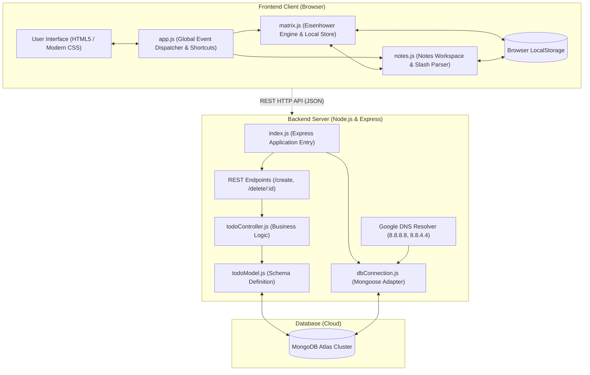
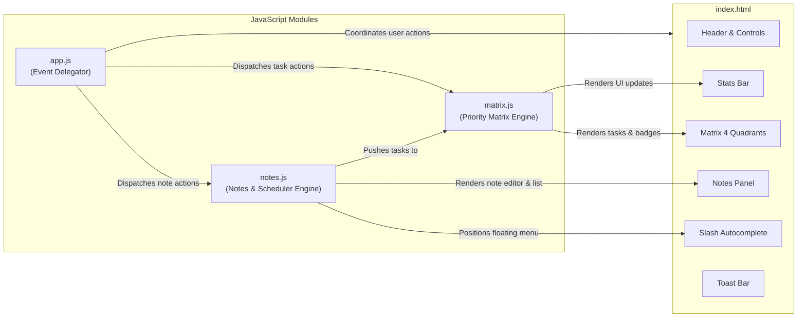
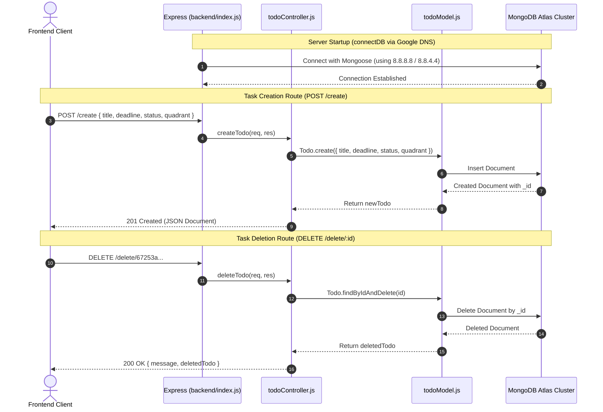

# Taskora - Technical Architecture & System Documentation

Taskora is a fullstack productivity application designed around the **Eisenhower Matrix methodology** (Urgent vs. Important). It couples an interactive 4-quadrant task prioritization matrix with a dockable, rich-text notes workspace capable of parsing tagged lines into matrix tasks via slash commands.

---

## 1. High-Level Architecture Overview



---

## 2. Directory Structure & Component Roles

```
Taskora/
├── backend/                        # Server-side application
│   ├── config/
│   │   └── dbConnection.js         # MongoDB connection with custom DNS resolution
│   ├── controllers/
│   │   └── todoController.js       # HTTP request handlers (create, delete)
│   ├── models/
│   │   └── todoModel.js            # Mongoose schema for task documents
│   └── index.js                    # Express app bootstrap and route registration
│
├── frontend/                       # Client-side application
│   ├── assets/
│   │   └── favicon.svg             # Application logo icon
│   ├── css/
│   │   ├── style.css               # Core layout, matrix grid, notes drawer, responsive design
│   │   └── themes.css              # CSS custom properties for 'dark' and 'slate' themes
│   ├── js/
│   │   ├── app.js                  # Central event listener delegation & keyboard shortcuts
│   │   ├── matrix.js               # Eisenhower Matrix logic, sorting, persistence, analytics
│   │   └── notes.js                # Notes workspace, live syntax highlighter, slash parser
│   └── index.html                  # Single-page semantic UI structure
│
├── docs/                           # Documentation
│   ├── PRD.md                      # Product Requirements Document
│   └── TECHNICAL_DOCS.md           # This Architecture & Engineering Document
│
├── .env                            # Environment variables (PORT, MONGO_URI)
├── .gitignore                      # Git ignored files (node_modules, .env)
├── index.html                      # Root redirect to /frontend/ (for Live Server)
├── package.json                    # Project dependencies, metadata, and scripts
└── package-lock.json               # Deterministic dependency lockfile
```

---

## 3. Frontend Architecture

The frontend is built using standard **vanilla JavaScript (ES6+)**, clean semantic HTML5, and responsive CSS with zero heavy third-party framework overhead. It is organized into three distinct, cooperating modules:



### 3.1 Eisenhower Matrix Engine (`matrix.js`)
* **File:** `frontend/js/matrix.js`
* **Role:** Manages the task data structure, prioritization logic, due dates, and rendering.

#### Core Concepts:
1. **The 4 Quadrants (`QUADRANTS` / `Q`):**
   * **`do` (DO NOW):** Urgent and Important (action required within 24–48 hours).
   * **`decide` (DEEP WORK):** Important, but not urgent (protect time for long-term goals).
   * **`delegate` (DELEGATE):** Urgent, but not important (hand off or batch quickly).
   * **`delete` (DROP):** Neither urgent nor important (low value, eliminate).
2. **Deterministic Task Sorting (`sortTasks`):**
   * Tasks are sorted with a strict 3-tier priority:
     1. **Completion status:** Incomplete tasks appear before completed ones.
     2. **Due Date:** Earliest deadlines appear first; tasks without a deadline sort to the bottom (`Infinity`).
     3. **Creation Order:** Ties are broken by newest creation timestamp.
3. **Due Date Badge Calculation (`dueBadge`):**
   * Compares the task's deadline timestamp against `todayStr` using `ONE_DAY_IN_MS = 24 * 60 * 60 * 1000`.
   * Displays dynamic badges: `Overdue` (styled red), `Today`, `Tomorrow`, or formatted date string (`Nov 15`).
4. **Local Persistence & Seeding (`loadTasks`, `saveTasks`, `seed`):**
   * Stores JSON serialized tasks under the key `'taskora-matrix-v1'`.
   * New users receive a starter seed of 7 demo tasks across all four boxes.
5. **Analytics & Progress (`render`):**
   * Recalculates total, open, and completed counts.
   * Generates a segmented visual bar showing the task distribution across each box.

---

### 3.2 Notes Workspace & Slash Commands Engine (`notes.js`)
* **File:** `frontend/js/notes.js`
* **Role:** Manages multi-note editing, rich-text command formatting, live syntax highlighting, tag autocompletion, and scheduling lines into the matrix.

#### Core Concepts:
1. **Notebook State Model (`notebook` / `nb`):**
   * Stores an array of note objects (`{ id, title, html, updated }`) and the currently active `currentNoteId`.
   * Automatically synchronizes changes to LocalStorage under `'taskora-notes-v2'`.
2. **Cursor-Preserving Syntax Highlighting (`highlightSlashCommands`):**
   * Scans contenteditable lines for slash tags (`/do now`, `/deep work`, `/delegate`, `/drop`).
   * Replaces them with `<span class="cmd">` badges.
   * Crucially uses `getCaretCharacterOffset()` and `restoreCaretOffset()` via `TreeWalker` so the user's cursor does not jump or glitch while typing.
3. **Slash Dropdown Autocomplete (`checkSlashMenuTrigger`, `selectSlashCommand`):**
   * Listens to cursor position when typing `/`.
   * Calculates the exact bounding box of the cursor using `Selection.getRangeAt(0).getBoundingClientRect()` and positions `#slash` right below it.
   * Enables arrow-key navigation (`ArrowUp`, `ArrowDown`, `Enter`, `Escape`).
4. **Natural Note Parser (`parseNoteTasks`):**
   * Scans note text line-by-line.
   * Lines following a `/tag` heading are collected into that quadrant.
   * Un-tagged lines are analyzed by a heuristic NLP keyword router (`urgent`, `today`, `important`, `priority`).
5. **Note-to-Matrix Scheduling (`scheduleNoteTasks`):**
   * Converts all detected lines into standard matrix tasks with unique timestamps.
   * Injects them directly into `tasks[]` in `matrix.js` and calls `saveTasks()` and `render()`.

---

### 3.3 Global Event Dispatcher & Shortcuts (`app.js`)
* **File:** `frontend/js/app.js`
* **Role:** Centralized controller that listens for user interaction and delegates tasks.

#### Event Handling Architecture:
* **Event Delegation Pattern:** Rather than attaching hundreds of individual event listeners to buttons and list items, single event listeners are attached to `document`:
  * `document.addEventListener('click', ...)`: Handles clicks on Add, Delete, Save, Cancel, Dock Mode, Formatting, and Note Selection.
  * `document.addEventListener('mousedown', ...)`: Prevents toolbar buttons from stealing caret focus from the contenteditable editor (`e.preventDefault()`).
  * `document.addEventListener('input', ...)`: Manages live notes syntax highlighting, autosave, and search filtering.
  * `document.addEventListener('change', ...)`: Manages task checkboxes, quadrant reassignment (`select.mv`), styles, and themes.
  * `document.addEventListener('dblclick', ...)`: Triggers inline task editing and fast note title renaming.
* **Keyboard Shortcuts Table:**

| Key | Context | Action |
| :--- | :--- | :--- |
| `/` | Anywhere (outside inputs) | Focus primary input in the DO NOW box |
| `F` or `f` | Anywhere (outside inputs) | Toggle Focus Mode (hides Delegate & Drop) |
| `Space` | Focused task | Toggle task completion |
| `Enter` | Quadrant input field | Submit and create task |
| `Enter` | Inline task edit | Save updated task title and date |
| `Ctrl / ⌘ + Enter`| Inside Notes panel | Parse and schedule note lines to matrix |
| `ArrowUp / Down` | Slash menu active | Navigate autocomplete tags |
| `Escape` | Modal / Notes / Slash / Edit | Dismiss / cancel active element |

---

## 4. Backend Architecture

The backend is built with **Node.js, Express, and Mongoose**, providing persistent cloud database capabilities.



### 4.1 Server Entry Point (`backend/index.js`)
* **File:** `backend/index.js`
* Loads environment variables using `dotenv`.
* Utilizes ES modules (`import`/`export`) enabled via `"type": "module"` in `package.json`.
* Executes `await connectDB()` to guarantee the database connection is live before accepting HTTP traffic.
* Registers middleware: `express.json()` for parsing incoming JSON bodies.
* Exposes routes:
  * `POST /create`: Invokes `createTodo`.
  * `DELETE /delete/:id`: Invokes `deleteTodo`.

### 4.2 Database Configuration & DNS Resolution (`backend/config/dbConnection.js`)
* **File:** `backend/config/dbConnection.js`
* **Custom DNS Override:**
  ```javascript
  import dns from 'dns';
  dns.setServers(['8.8.8.8', '8.8.4.4']);
  ```
  MongoDB Atlas `mongodb+srv://` connection strings rely on DNS SRV records. On certain Windows networks and ISPs, default local DNS fails with `querySrv ECONNREFUSED`. Forcing Node's internal resolver to Google Public DNS (`8.8.8.8`, `8.8.4.4`) resolves this issue completely.

### 4.3 Mongoose Data Model (`backend/models/todoModel.js`)
* **File:** `backend/models/todoModel.js`
* Schema structure:

| Field | Type | Required | Default | Allowed Values / Constraints |
| :--- | :--- | :--- | :--- | :--- |
| `title` | `String` | Yes | - | Trimmed, non-empty text |
| `deadline` | `Date` | No | `null` | ISO 8601 Date or timestamp |
| `status` | `String` | No | `'pending'` | `'pending'`, `'completed'` |
| `quadrant` | `String` | No | `'do'` | `'do'`, `'decide'`, `'delegate'`, `'delete'` |
| `createdAt` | `Date` | Auto | Timestamp | Managed by Mongoose `timestamps: true` |
| `updatedAt` | `Date` | Auto | Timestamp | Managed by Mongoose `timestamps: true` |

### 4.4 Controller Endpoints (`backend/controllers/todoController.js`)
* **File:** `backend/controllers/todoController.js`
* **`createTodo(req, res)`**:
  * Validates presence of `title` (returns `400 Bad Request` if missing).
  * Creates document with defaults for `status` and `quadrant`.
  * Returns `201 Created` with newly created MongoDB document.
* **`deleteTodo(req, res)`**:
  * Resolves ID from URL parameter (`req.params.id`) or request body (`req.body.id`).
  * Executes `findByIdAndDelete(id)`.
  * Returns `404 Not Found` if task does not exist.
  * Returns `200 OK` with confirmation message upon success.

---

## 5. How Frontend and Backend Connect

Taskora currently provides **two synchronization modes**:

1. **Client-Side Mode (Active in Frontend by Default):**
   * Uses `localStorage` to give instant offline access with zero latency.
   * Tasks are saved under `'taskora-matrix-v1'` and notes under `'taskora-notes-v2'`.
2. **Cloud Fullstack Mode (Backend API):**
   * The backend provides endpoints `POST /create` and `DELETE /delete/:id` matching the exact schema of client tasks.
   * To synchronize client actions to the cloud backend, a `fetch()` call is dispatched on task creation and deletion:

```javascript
// Example: Connecting client addTask() to backend API
async function apiCreateTask(taskData) {
  const response = await fetch('http://localhost:3000/create', {
    method: 'POST',
    headers: { 'Content-Type': 'application/json' },
    body: JSON.stringify({
      title: taskData.title,
      deadline: taskData.due || null,
      status: taskData.done ? 'completed' : 'pending',
      quadrant: taskData.q
    })
  });
  return await response.json();
}
```

---

## 6. How to Run and Test the Project

### Running the Backend Server
```bash
npm install           # Install dependencies
npm run dev           # Starts server with nodemon on http://localhost:3000
```

### Running the Frontend
* **VS Code Live Server:** Right-click `frontend/index.html` (or root `index.html`) and select **"Open with Live Server"**.
* **Any Static HTTP Server:**
  ```bash
  npx serve frontend
  ```
